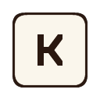
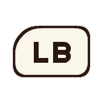
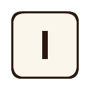
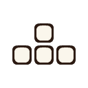
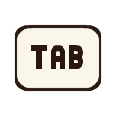
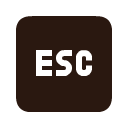

# Eternal Darkness Recomp

[](https://github.com/griches/EternalDarknessRecomp/stargazers)
[](https://github.com/griches/EternalDarknessRecomp/releases/latest)
[](LICENSE)

**Eternal Darkness: Sanity's Requiem** (GameCube, 2002) as a native game for the Mac,
Windows and Linux / Steam Deck, built from **your own disc**. Nothing from the game
is in this repository. The PlayStation 5 version is
[PS5_EternalDarkness](https://github.com/griches/PS5_EternalDarkness).
Version 0.9.4.

> **European disc only.** You need your own image (`.iso` or `.gcm`) of the
> **European GameCube disc, `GEDP01`**. The USA disc (`GEDE01`) is not supported:
> the launcher does not offer it and the installers turn it away.

## What you need

- Your own image of the European disc: an `.iso` or `.gcm` file.
- For the HD textures, a program that opens `.7z` files: 7-Zip on Windows, Keka
  or The Unarchiver on a Mac, Ark on a Steam Deck's desktop.

## Set it up

### 1. The game

- **Mac** (Apple silicon, macOS 13 or later)
  1. Download `EternalDarkness-mac-....zip` from the
     [latest release](https://github.com/griches/EternalDarknessRecomp/releases/latest),
     unzip it and move **Eternal Darkness.app** to Applications.
  2. The first time, right-click the app, choose **Open**, then **Open** again
     (it is not notarised).
  3. Drop your disc image on its window. It translates the disc and builds the
     game from it (a minute or two), then starts. Later starts are instant.
- **Windows** (64-bit)
  1. Download `EternalDarkness-windows-x64-....zip` from the
     [latest release](https://github.com/griches/EternalDarknessRecomp/releases/latest)
     and unzip it somewhere you can write to, such as Documents or a Games
     folder (not Program Files). You get a folder called `EternalDarknessRecomp`.
  2. Put your disc image in its `dump` folder.
  3. Double-click `play.bat`. If Windows says it protected your PC, click
     **More info**, then **Run anyway**. The game's program comes ready-made;
     its graphics, sound and music come from your disc.
- **Steam Deck / Linux** (x86-64)
  1. Download `EternalDarkness-linux-x86_64-....tar.gz` from the
     [latest release](https://github.com/griches/EternalDarknessRecomp/releases/latest)
     and unpack it somewhere such as `~/Games` (on a Deck, Ark does it in
     Desktop Mode). You get a folder called `EternalDarknessRecomp`.
  2. Put your disc image in that folder.
  3. Run `play.sh`. On a Deck: Desktop Mode, Steam > Add a Non-Steam Game >
     Browse > `play.sh`, then play it from Game Mode. The first start
     translates your disc and builds the game from it (about a minute on a
     Deck); after that it starts straight away.

### 2. The HD textures (recommended)

Two downloads, both DDS:

| Download | What it is | Size |
| --- | --- | --- |
| **[Eternal Darkness HD Texture Pack](https://drive.google.com/file/d/1KGEr7dF2onTdzUFNp7Lia3p0D0I2-TaZ/view)** by Zombie | The game's textures redrawn at four times the detail | 2.9&nbsp;GB&nbsp;`.7z` |
| **[PAL supplement](https://drive.google.com/file/d/1BuoE0uL4K3xn5KfH8KYYtC6fk-6QiiiA/view)** by Eternal Darkness Recomp | What the pack misses on the European disc: the Jump to Game, Options and Language screens and the title menu's words, and highlights without hard edges | 13.2&nbsp;MB&nbsp;`.zip` |

1. Unpack both. Each one gives you a folder.
2. Put both folders in a folder called `textures` (make it if it isn't there):
   - Mac app: `~/Library/Application Support/Eternal Darkness/textures`
     (in Finder, **Go > Go to Folder** and paste the path)
   - Steam Deck, Linux and Windows: `textures` in the game's folder, next to
     `res`

Leave both folders as they are: the supplement replaces some of the pack's
textures on purpose, and a folder with *supplement* in its name always wins.
DDS stays compressed on the graphics card, a quarter of the memory PNG takes.

The pack is the work of **Zombie**, shared on the
[Dolphin forums](https://forums.dolphin-emu.org/Thread-eternal-darkness-hd).

### 3. Check the folder

When you're done, `textures` looks like this:

```
textures/
├── GED DDS 1.0/
└── Eternal Darkness HD Texture Pack PAL supplement/
```

`GED DDS 1.0` is Zombie's pack; the folders' names don't matter.

### 4. Play

Start the game and choose **New game** in the launcher. The defaults are
already the best picture: your screen's own resolution, widescreen, HD textures
on and sharp baked shadows. In **Options > Game**, **HD textures** should say
**On**, and its note gives the number of textures it found.

### If something's wrong

- **The Mac says the app can't be opened**: right-click it and choose **Open**
  (step 2 above).
- **The disc isn't accepted**: only the European disc (`GEDP01`) works, as an
  `.iso` or `.gcm`.
- **HD textures says No pack**: the pack isn't inside `textures`. Check the
  folder against the one above, then start the game again: it looks for the
  pack as it starts.
- **Anything else**: send the files in `saves/reports/` with a few words on what
  you were doing.

### Updating

Put the new build in place of the old one (on a Mac, the new app in
Applications). Saves, settings and textures stay where they are: in the game's
folder, or the Mac app's
`~/Library/Application Support/Eternal Darkness`.

## What is better than on the GameCube

- **Sharp picture at any resolution**: drawn at your screen's own resolution, up
  to 4K, or a fixed 720p, 1080p, 1440p or 4K, with full colour (no 6-bit banding).
- **Widescreen**: the game's own 16:9 mode (more of the room at the sides, not
  stretched) with the HUD and prompts at the screen's edges; 4:3 too.
- **Smoother on a fast screen**: on a 90, 120 Hz or faster screen, frames in
  between the game's 60 (Options > Frame rate).
- **Fast-forward the cutscenes**: while a movie or a scene in the black bars
  plays, hold RB (Tab on the keyboard) to run it at up to four times speed.
- **Camera options** (Options > Game > Camera): the game's own fixed cameras,
  *Third person (beta)* (behind the character you play, turned with the right stick, up and down
  for closer or further, and kept inside the room by the game's own collision)
  or *First person (beta)* (through their eyes, looking around with the right stick). Both hold still while you aim.
- **New baked shadows** (below): the rooms' light and shadow redrawn sharp.
- **Crisp game text**: the game's lettering redrawn in two styles, *Sharp* or
  *Tome* (old typefaces), or *Original* as on the disc.
- **HD texture packs** in Dolphin's format.
- **Modern controls**, remapping, and button prompts that match your controller
  (Xbox, PlayStation or Switch icons), the game's own prompts included.
- **Save anywhere**: the pause menu has four save slots that hold the whole moment,
  besides the game's own memory-card saves (cards in slots A and B both work).
- **A launcher**: Continue, New game or any save slot straight from the start,
  and Options for everything here.
- **Problem reports**: if the game stops responding, stops or crashes, it says
  so on screen and writes a report to `saves/reports/` to send.

## Controls

A controller works as it is; the keyboard works too. Two layouts and your own:

| Action | Modern (default) | Original (GameCube positions) | Keyboard |
| --- | --- | --- | --- |
| Move |  |  |  |
| Attack / Confirm |  or  |  |  |
| Action / Cancel |  |  |  |
| Target / Aim |  or  |  |  |
| Sprint |  toggle, or hold  |  |  |
| Creep |  toggle |  |  |
| Reload |  |  |  |
| Quickcast |  |  |  |
| Spells |  |  |  |
| Game's pause menu |  |  |  |
| Fast-forward a cutscene (hold) |  |  |  |
| This port's menu (saves, options) |  |  |  |

PlayStation and Switch controllers use the same buttons in the same places, and
the game shows your controller's own icons.

In the game's own menus LB and RB page left and right (the GameCube's L and R).
**Options > Controls** switches layout, makes Sprint, Creep and Target hold or
toggle, sets the stick deadzone and vibration, and **Button mapping** rebinds any
action to a button, trigger or key (that layout is *Custom*).

## The new baked shadows

Eternal Darkness lights its rooms with pre-drawn light maps: the window light on
the floors, the shadows under the furniture, the glow of the lamps. On the disc
they are small and compressed, so at today's resolutions their edges break up
into blocks and smears. With **Options > Game > Baked shadows: Sharp** (the
default) each room's light maps are rebuilt four times larger as the room loads:
the compression blocks are evened out and edges are doubled along their own
direction, so light and shadow keep clean edges; the small maps on the walls are
smoothed instead. **Original** shows them as on the disc. The change shows as soon
as you switch.

## Playing

- The launcher's **Play** offers Continue (your newest save slot), New game or
  any slot. **Options** holds the display, sound, controls and game settings.
- In the game, the menu button (above) or **Esc** opens this port's pause menu:
  four save slots, Options, Return to title screen, Return to launcher, Quit.
- Saves: `saves/` (the pause menu's slots) and `ed-GEDP01-slot-a.dolcard` (the
  game's memory card; a `...-slot-b.dolcard` beside it is slot B).
- If something goes wrong, send the files in `saves/reports/` with a few words on
  what you were doing.

## How it works

The game's PowerPC code is translated to C by
[DolRecomp](https://github.com/ExpansionPak/DolRecomp) and compiled for your
machine; it runs on [GXRuntime](https://github.com/aharonahdoot/GXRuntime), which
supplies the GameCube's CPU state, devices and SDK services, and draws through its
gxcore renderer (the GameCube's GX graphics, after Dolphin's) on Aurora and Dawn
(Metal, Direct3D 12 or Vulkan). `generated/` (code translated from your disc) and
`dump/` (your disc image) stay on your machine.

## Building from source

All platforms start the same way:

```sh
tools/setup-deps.sh                           # pinned DolRecomp + GXRuntime, plus our patches
python3 tools/generate.py /path/to/disc.iso   # ISO or CISO; writes generated/
cp /path/to/disc.iso dump/GEDP01.iso          # the European disc
```

- **Mac**: `cmake -S . -B build-mac -G Ninja && ninja -C build-mac EternalDarkness`,
  then `./play.sh`. `tools/mac/make-mac-app.sh` builds a self-contained
  `Eternal Darkness.app` (beta) that asks for your disc and builds the game
  from it on first start (`tools/mac/README.txt`).
- **Windows**: configure with clang-cl and Ninja (`build-win`), build
  `EternalDarkness`, copy the DLLs from the build tree next to the exe, then
  `play.bat`. For the release folder, `tools/win/stage-win-build.bat` on the
  PC gathers the build, then `tools/win/make-win-package.sh` on a Mac zips it.
- **Linux / Steam Deck**: build with clang and Ninja (`build-linux`);
  `tools/deck/make-deck-package.sh` makes a folder that builds the game from
  your disc on first start (`tools/deck/README.txt`).

`./play.sh` opens the launcher. The first time, pick the disc (images in
`dump/` or the project folder; this build runs the disc it was generated from);
after that it lives in Options and the menu leads with Play. Play offers
Continue (the newest save slot), New game, or any used slot, so a save loads
without going through the game first. In the game, Esc or the controller's Back/Select button pauses into a
menu with four save slots (`saves/`), the same options, and a way back to the
launcher. Menus work with the keyboard (arrows, Enter, Esc), a controller
(d-pad or stick, A, B) or the mouse.

Options (kept in `settings.ini`): aspect ratio (4:3 or 16:9, the
game's own two; it sets the game's widescreen option), widescreen HUD, resolution (each
choice shows its size), fullscreen, on-screen FPS counter (off by default), camera
(Original, Third person (beta) or First person (beta); the right stick, or T F G H, turns it), baked shadows
(Sharp: each room's light maps are upscaled 4x as it loads, with CMPR's blocks
evened out and edge-directed doubling, so window light and shadows on the
walls and floors have clean edges; Original: as on the disc), music and
sound-effect volumes, audio buffer, and Controls: Original (GameCube
positions), Modern (attack RT/A, action B, aim LT, sprint and creep on the stick clicks
as toggles, LB/RB as the GameCube L/R for paging the game's menus, reload
X/Square, quickcast Y/Triangle) or
Custom (select an action, then press a button, trigger or key), Sprint, Creep
and Target as hold or toggle, stick deadzone and vibration. Bindings show
as Xbox, PlayStation or Switch button icons for the connected controller, and
the game's own prompts ("B Examine", the inventory's L/R) are redrawn with the
same icons for the button that does each action (keyboard keys with no
controller).

Quick save: 2 saves the whole machine to `build/runs/quick.state` and 1 loads
it back, in the same session or after a restart (`ED_QUICKSTATE=path` picks
another file). Memory-card saves are never touched by a load.

Memory cards: slot A is `ed-GEDP01-slot-a.dolcard` (the disc's game ID in the
name) in the folder the game runs from. A card beside it named
`...-slot-b.dolcard`, or one given with `--card-b PATH` or `ED_CARD_B=path`,
goes in slot B, and the game's Load Game and Save screens offer it there.
The console's own settings sit beside slot A as `...-sram.bin`: the game takes
its Audio Mode from them at start, as on a GameCube, and writes them when you
change it. Without that file a new game starts in Stereo.
`tools/gci.py` lists a card and moves saves in and out as GCI files (as
Dolphin exports them; MaxDrive `.sav` and GameShark `.gcs` import too).

## Layout

- `runtime/host/`: the game's host layer (SDK intercepts, interrupts, disc,
  audio and disc-music streaming), derived from
  [StrikersRecomp](https://github.com/aharonahdoot/StrikersRecomp)'s host.
- `tools/`: disc reading and code generation (`generate.py`), the symbol map
  carried from the USA decomp to the PAL disc (`symbols.py`), per-build
  constants read from the game's code (`gamedata.py`), and debugging helpers.
- `config/GEDE01/symbols.txt`: function names from the
  [unending-occlusion](https://github.com/PattyTrish/unending-occlusion) decomp (CC0).
- `patches/gxruntime/`, `patches/dolrecomp/`: fixes to GXRuntime and the
  recompiler this game needs.
- `res/icon/`: the Eternal Darkness Recomp emblem (window and Dock icon,
  `AppIcon.icns` for the Mac app).
- `res/`: the launcher and in-game menu (RmlUi documents) and their fonts
  (Alegreya SC and Fira Sans, SIL Open Font License, licences alongside), and
  button icons from Kenney's Input Prompts (CC0).

## Licence

GPL-3.0-or-later (see `LICENSE`), as the GXRuntime and StrikersRecomp code it
builds on. `THIRD_PARTY.md` lists everything else a build holds and its
licence; every package carries their texts in `licenses/`.
